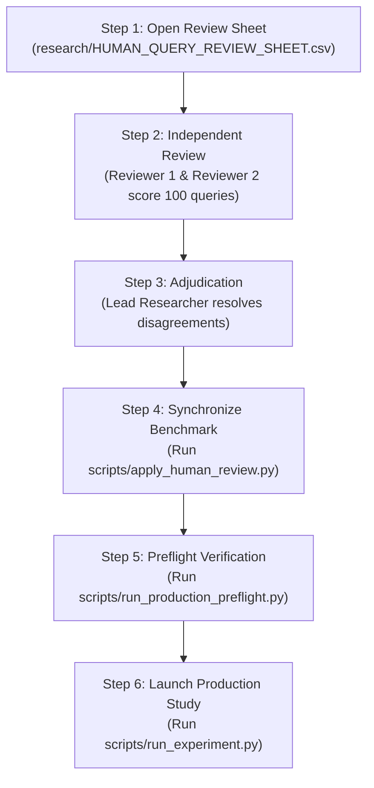

# HUMAN_TASKS_TO_COMPLETE.md
# Action Plan: Remaining Human Tasks for Research Completion

**Project:** Cross-Lingual RAG Faithfulness Evaluation under Code-Mixing  
**Target Audience:** Research Coordinators, Principal Investigators, and Bilingual Reviewers (Non-programmer friendly)  
**Current Gate:** `BLOCKED — HUMAN BILINGUAL REVIEW REQUIRED`  
**Machine-Verified Status (2026-10-27 22:31 IST):** 0 / 100 reviewer decisions entered. All rows in `research/HUMAN_QUERY_REVIEW_SHEET.csv` still contain placeholder `PENDING` values.  
**Purpose:** This document specifies the exact sequential steps that human researchers must execute before the automated production experiments can be launched.

---

## 1. Overview of Why Human Action is Required

Scientific and publication ethics for top NLP venues (ACL, EMNLP, SIGIR) require that benchmark datasets evaluating language capabilities cannot be validated solely by AI models. Because the code-mixed queries (Tamil-English and Hindi-English) were synthesized during dataset construction, **two qualified bilingual humans** must independently evaluate and approve each query before we can measure how RAG systems perform on them.

---

## 2. Step-by-Step Human Workflow



---

### Step 1: Open the Review Spreadsheet
1. Open the file:
   `research/HUMAN_QUERY_REVIEW_SHEET.csv`
   *(You can open this in Microsoft Excel, Google Sheets, or LibreOffice Calc).*
2. The sheet contains **100 rows** (50 Tamil-English queries and 50 Hindi-English queries).
3. For each row, you will see:
   - `question_id`: Query identifier (e.g., `DEV-Q01`, `BANK-Q04`)
   - `language_variant`: `Tamil-English (Tanglish)` or `Hindi-English (Hinglish)`
   - `code_mixed_query`: The Romanized query under review
   - `english_reference_query`: The original English question
   - `domain` and `category`: Context (e.g., Banking, Telecom)
   - `gold_evidence_snippet`: The document text snippet that contains the answer

---

### Step 2: Conduct Independent Bilingual Reviews
Recruit two bilingual evaluators:
* **Reviewer 1** completes columns **I through O**:
  - `reviewer_1_id`: Anonymized identifier (e.g., `REV-01`)
  - `reviewer_1_semantic_preservation_1to5`: Rate 1 (poor) to 5 (exact match)
  - `reviewer_1_naturalness_1to5`: Rate 1 (robotic/broken) to 5 (authentic colloquial chat)
  - `reviewer_1_entity_constraint_preservation`: Enter `YES` or `NO` (checks numbers, amounts, product names)
  - `reviewer_1_decision`: Enter `ACCEPT`, `REVISE`, or `REJECT`
  - `reviewer_1_proposed_revision`: (If `REVISE`, provide the corrected Romanized wording)
  - `reviewer_1_comments`: Any notes or dialect observations
* **Reviewer 2** completes columns **P through V** independently:
  - Enters `reviewer_2_id`, scores, decision (`ACCEPT`/`REVISE`/`REJECT`), proposed revision, and comments.

*Note: Reviewers should refer to [research/HUMAN_QUERY_REVIEW_GUIDE.md](file:///C:/Users/NIRANJNA/.gemini/antigravity-ide/scratch/cross-lingual-rag-eval/research/HUMAN_QUERY_REVIEW_GUIDE.md) for concrete scoring examples.*

---

### Step 3: Adjudication of Discrepancies
The Lead Researcher or Adjudicator reviews rows where Reviewer 1 and Reviewer 2 disagree:
1. Complete columns **W through Z**:
   - `adjudicator_id`: Name or ID of adjudicator
   - `adjudication_decision`:
     - `ACCEPT_ORIGINAL` (if both reviewers accepted or original is confirmed sound)
     - `ACCEPT_REVISION` (if a reviewer's proposed revision is adopted)
     - `REJECT_REPLACE` (if the query is flawed and must be rewritten)
   - `final_approved_query_text`: Paste the final verified query text to be used in the benchmark
   - `adjudication_notes`: Brief justification for the decision
2. Save and close `research/HUMAN_QUERY_REVIEW_SHEET.csv`.

---

### Step 4: Synchronize Benchmark
Once the spreadsheet is fully adjudicated, run the synchronization script:
```powershell
.\venv\Scripts\python.exe scripts/apply_human_review.py
```
*(This script copies the final approved queries into `data/queries/final_queries_v1.json`, marks them `VERIFIED_GOLD`, and clears `research/HUMAN_REVIEW_BLOCKERS.md`).*

---

### Step 5: Run Production Preflight
Run the fail-closed preflight safety validator:
```powershell
.\venv\Scripts\python.exe scripts/run_production_preflight.py
```
*Expected output: `[PASS] ALL PRODUCTION PREFLIGHT CHECKS PASSED.`*

---

### Step 6: Launch Authorized Production Study
With preflight passing, execute the 300 production experiment runs into the isolated database:
```powershell
.\venv\Scripts\python.exe scripts/run_experiment.py --all --production --db data/research_study.db
```

---

## 3. Checklist of Required Evidence Before Launch

Do not start the experiment until every box can be checked honestly:
- [ ] 100 out of 100 rows in `HUMAN_QUERY_REVIEW_SHEET.csv` have scores from Reviewer 1.
- [ ] 100 out of 100 rows in `HUMAN_QUERY_REVIEW_SHEET.csv` have scores from Reviewer 2.
- [ ] All rows with `REVISE` or `REJECT` have an explicit adjudicator decision and final text.
- [ ] No `PENDING` entries remain in the sheet.
- [ ] `final_queries_v1.json` has been updated with the final approved text.
- [ ] Preflight validation passes with zero errors.
